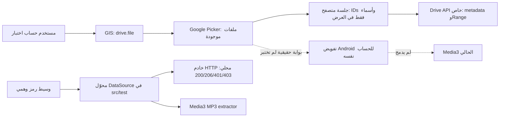

# إثبات جدوى Google Drive — تجربة معزولة

التاريخ: 29 أكتوبر 2026. الأساس: `dev/local-audio` عند
`02705d59e91c071d121a7b4841273d89980298ff`. فرع العمل المحلي: `dev/drive-poc`.

هذه تجربة قبل تطوير الميزة. لم تتغير الشيفرة التشغيلية أو قاعدة البيانات أو التبعيات أو واجهة FireTube.
لم تُستخدم حسابات Google أو مفاتيح فعلية، ولم يُختبر تشغيل على هاتف. لا يوجد رفع إلى GitHub.

## النتيجة وحدودها

أثبتت الاختبارات المحلية إمكانية تمرير استجابة HTTP خاصة إلى Media3 الحالي، والتحقق من Range،
وإعادة المحاولة المحدودة بعد 401، وفصل الرموز عن روابط التطبيق والبيانات المعروضة. أثبتت تجربة SAF
المحلية قراءة مستند عبر `content://` والانتقال داخله إذا كان واصف الموفّر قابلًا للبحث.

**لم يثبت بعد منح `drive.file` لملف موجود مسبقًا بواسطة Picker، ولا مشاركة هذا المنح مع عميل Android،
ولا تشغيل ملف من Google Drive الحقيقي.** أصبح لدينا نموذج قابل للتشغيل عند توفير إعدادات Cloud
وحساب اختبار؛ الاختبارات الوهمية لا تثبت قبول Google أو سياسات النشر أو سلامة التطبيق بكامله.

التوصية: متابعة اختبار Picker مع `drive.file` وحساب اختبار، ثم اختبار عميل Android مستقل في المشروع
والحساب نفسيهما. لا نبدأ دمج الميزة قبل نجاح هاتين البوابتين ومراجعة الوثائق المحجوبة.
لا تظهر حاجة معمارية لخادم أو Firebase إضافي أو خدمة مدفوعة؛ **لا يمكن تأكيد غياب جميع التكاليف
الإلزامية للنشر العام** قبل التحقق من تصنيف النطاق وسياسات المراجعة وحدود الاستخدام الحالية.

## المصادر الرسمية والوصول الفعلي

أُعيد طلب الصفحات التالية عبر وكيل الشبكة الموروث مع TLS صحيح يوم 29 أكتوبر 2026.
الصفحات العشر جميعها فشلت بـ`Tunnel connection failed: 403 Forbidden` قبل الوصول إلى الموقع.
هذا حظر شبكة البيئة، وليس استجابة OAuth أو Drive تفيد رفض حساب أو نطاق.

| المرجع | الموضوع | النتيجة |
| --- | --- | --- |
| [Android authorization](https://developers.google.com/identity/authorization/android) | تفويض Android | محجوب |
| [GIS token model](https://developers.google.com/identity/oauth2/web/guides/use-token-model) | رمز المتصفح | محجوب |
| [Drive scopes](https://developers.google.com/workspace/drive/api/guides/api-specific-auth) | الصلاحيات وتصنيفها | محجوب |
| [Drive downloads](https://developers.google.com/workspace/drive/api/guides/manage-downloads) | المحتوى وRange | محجوب |
| [Google Picker](https://developers.google.com/workspace/drive/picker/guides/overview) | اختيار الملفات | محجوب |
| [Restricted verification](https://developers.google.com/identity/protocols/oauth2/production-readiness/restricted-scope-verification) | متطلبات النشر | محجوب |
| [User Data Policy](https://developers.google.com/terms/api-services-user-data-policy) | استخدام بيانات المستخدم | محجوب |
| [Drive limits](https://developers.google.com/workspace/drive/api/guides/limits) | الحصص والتكاليف | محجوب |
| [OAuth verification help](https://support.google.com/cloud/answer/9110914) | إجراءات التحقق | محجوب |
| [Android SAF](https://developer.android.com/training/data-storage/shared/documents-files) | المستندات والصلاحيات | محجوب |

لإكمال المراجعة اسمح في شبكة البيئة بـ`developers.google.com` و`support.google.com`
و`developer.android.com` ثم أعد تشغيل `python3 tools/drive-poc/check_docs.py`.
لا يكفي تغيير قائمة السماح دون التأكد من استجابة الطلبات. لم أغير إعدادات الشبكة.

مصادر Google التي قُرئت بنجاح من مستودعاتها الرسمية على GitHub:

* [Drive discovery schema](https://github.com/googleapis/google-api-go-client/blob/main/drive/v3/drive-api.json)،
  المراجعة `20261023`: تعريف `drive.file` هو الوصول إلى الملفات المحددة المستخدمة مع التطبيق؛
  `files.get` يقبل هذا النطاق ويدعم المحتوى عبر `alt=media`. هذا لا يثبت حصول حساب معين على المنح.
* [Picker browser sample](https://github.com/googleworkspace/browser-samples/blob/main/drive/picker/helloworld.html):
  نموذج GIS ثم `PickerBuilder` مع `setOAuthToken` و`setAppId` و`setDeveloperKey` ومعرّفات الملفات المختارة.
  **المثال يطلب `drive.metadata.readonly` وليس `drive.file`**، ولذلك لا يُعد اختبارًا جاهزًا لمطلبنا.
* [Android identity samples](https://github.com/android/identity-samples): أمثلة الهوية، وليست دليلًا
  على منح Drive أو بديلًا عن توثيق `AuthorizationClient`.

## مسار التفويض والاختيار المقترح

1. يسجل المستخدم التفويض في متصفح النظام/الويب عبر Google Identity Services؛ طلب التجربة هو
   `drive.file` فقط، مع تعطيل جمع النطاقات السابقة في الطلب واختيار الحساب صراحة.
2. يفتح Picker في مشروع Cloud نفسه، ويختار المستخدم ملفات صوتية **رفعها مسبقًا خارج التطبيق**.
   نعرض المجلدات للتنقل ولا نسمح باختيار مجلد بوصفه منحًا شاملًا لأبنائه. لا يوجد رفع أو تعديل ملفات.
3. تُستخدم معرّفات الاختيار للوصول إلى `files.get`، ثم `files.get?alt=media` بترويسة Bearer.
   الحصول على معرّف من Picker أو معرفة رابط الملف ليس إثباتًا للصلاحية؛ نجاح API الحقيقي هو الإثبات.
4. في الاختبار اللاحق على Android يُطلب النطاق للحساب نفسه بواسطة `AuthorizationClient`،
   ويُختبر وصول رمز Android إلى الملف المختار في الويب. **لا ننقل رمز الويب إلى التطبيق في رابط رجوع**.
   نجاح عميل الويب وحده لا يثبت هذه الخطوة؛ قد نحتاج تعديل تصميم اختيار الملفات بعد نتيجتها.

لا يمكن استخدام `drive.file` للزعم بأن FireTube يستطيع سرد الحساب كله. `drive.readonly` يمنح قراءة
أوسع ويتطلب مراجعة مختلفة؛ لا يُطلب في التجربة. `drive.file` نفسه يتضمن صلاحيات كتابة للملفات الممنوحة،
رغم أن تجربتنا تستخدم GET فقط. تغيير النطاق الأوسع ليس حلًا تلقائيًا لأي فشل.
لا يصبح الملف عامًا، ولا ننشئ أذونات مشاركة أو روابط عامة.

## الشيفرة التجريبية

| الملف | المسؤولية |
| --- | --- |
| `tools/drive-poc/index.html` | صفحة منفصلة لإدخال إعدادات عامة؛ ليست شاشة في FireTube |
| `tools/drive-poc/browser.mjs` | تحميل GIS وPicker الرسميين، اختيار صوت متعدد، عرض أسماء باستخدام `textContent` و`bdi` |
| `tools/drive-poc/session.mjs` | نطاق وحيد، جلسة ذاكرة، رفض callbacks القديمة، طلبات خاصة، فحص Range محدود |
| `tools/drive-poc/session.test.mjs` | 17 اختبارًا بعوامل OAuth/Picker وfetch وهمية |
| `tools/drive-poc/check_docs.py` | إعادة فحص الوصول إلى المصادر الرسمية؛ بلا مصادقة أو تجاوز للوكيل |
| `app/src/test/kotlin/com/palmerintech/firetube/drivepoc/DrivePocDataSource.kt` | محوّل اختبار فقط فوق `OkHttpDataSource` الموجود؛ وسيط رموز وهمي مرتبط بجلسة واحدة |
| `app/src/test/kotlin/com/palmerintech/firetube/drivepoc/DriveTransportPocTest.kt` | 15 اختبار نقل HTTP حقيقي على loopback مع Media3 |
| `app/src/test/kotlin/com/palmerintech/firetube/drivepoc/SafTransportPocTest.kt` | 4 اختبارات موفّر مستندات وهمي وMedia3 |
| `docs/DRIVE_POC.md` | التقرير وخطوات الاستكمال |

لا تُجمع شيفرة `src/test` أو `tools` داخل APK. الموفّر المحلي يعرض fixture موجودًا؛ لا ينسخ
ملفات المستخدم إلى مساحة التطبيق. كل بيانات الاعتماد في الاختبارات قيم وهمية واضحة.



المسار المنقط مستقبلي. النموذج لا يشغّل الصوت في المتصفح أو التطبيق؛ يختبر الانتقاء والوصول
والنقل، ويثبت تعرف Media3 على MP3 التجريبي، وليس فك ترميز الصوت وإخراجه على هاتف.

## نتائج الاختبارات ومعنى كل نتيجة

* `206`: مطابقة البداية والنهاية والحجم في `Content-Range`، وقراءة البايتات المطلوبة بدقة في Media3.
  ترفض التجربة نطاقًا مفقودًا أو خاطئًا؛ ويختبر المتصفح أيضًا الاستجابة الجزئية المبتورة.
* `200`: مقبول من الموضع صفر، ويُحد مقدار القراءة المطلوب. بعد seek غير صفري يُرفض بدل
  قراءة موضع خاطئ أو إسقاط كامل البيانات السابقة بصمت. قد يجلب المتصفح/الوكيل بيانات إضافية مسبقًا؛
  حد القراءة التجريبي 4096 بايت ليس ضمانًا لحجم الاستهلاك الشبكي الفعلي.
  اختبار HTTP محلي يوقف الخادم بعد أول 64 بايت، ويثبت أن Media3 يعيد أول 32 بايت قبل
  السماح للخادم بإرسال البقية. هذا دليل تشغيل تدريجي للنقل المحلي فقط، وليس لخدمة Drive.
* `401`: محوّل Media3 يستدعي وسيط الرمز مرة للتجديد ويعيد Range نفسه؛ يتوقف عند 401 ثانية.
  هذا يثبت عقد إعادة المحاولة، **ولا يثبت قدرة Google SDK على تجديد رمز حقيقي**.
  نموذج المتصفح يمسح الجلسة ويطلب ضغطة تفويض جديدة، ولا يفتح نوافذ تلقائية متكررة.
* `403`: خطأ وصول مستقل، لا تجديد أعمى. `404`: غياب/عدم وصول صريح. لا تعيد التجربة المحاولة بلا حد.
* إعادة التوجيه ممنوعة في عميل الاختبار وطلبات المتصفح؛ لا ينتقل Bearer إلى مضيف آخر.
  لم يُثبت أن Drive الحقيقي لا يحتاج إعادة توجيه. إن احتاجها ندرس وجهاتها وقواعد الرموز قبل السماح بها.
* يبقى الرمز في ذاكرة الجلسة، ويُسلّم إلى SDK Picker الرسمي للتفويض. في طلبات Drive التي تنشئها
  تجربتنا يكون في ترويسة Authorization، خارج URI وDataSpec ونتائج العرض والتسلسل وروابط الرجوع.
  أخطاء HTTP لا تعرض أجسام الخادم أو الرمز. لا storage أو cookies للتطبيق أو سجلات رموز أو رموز داخل backup.
  هذا ليس تدقيقًا أمنيًا شاملًا للمتصفح أو إضافاته أو SDK خارجي. لا تصدّر HAR أو صور Network تحمل الرموز.
* تغيير/مسح الجلسة يبطل callbacks ونتائج الطلبات السابقة. لا نعتبر ذلك إثباتًا لهوية الحساب
  عبر الويب وAndroid؛ يلزم ربط حساب مستقل عند تطوير الميزة.
* أسماء مختلطة بالعبرية والعربية واليونانية والإنجليزية مع combining marks وemoji تبقى مطابقة؛
  لا normalization أو إعادة فك ترميز تخمينية، ولا تفسير للأسماء بوصفها HTML.

الأمور غير المختبرة: تسجيل الدخول الحقيقي، منح Picker، CORS وإظهار `Content-Range` في متصفح حقيقي،
اشتراك المنح بين عميلَي الويب وAndroid، حسابان حقيقيان، انتهاء/سحب رمز حقيقي، ملفات مشتركة وshortcuts
وresource keys، تغير نسخة الملف أثناء التشغيل، انقطاع الشبكة أثناء read واستئنافه، التخزين المؤقت،
صوت جميع الصيغ، الخلفية وإطفاء الشاشة. لم تُطوّر آلية تخزين OAuth أو ربط حساب دائم.

## SAF كبديل

| جانب | Picker + Drive API | Android Storage Access Framework |
| --- | --- | --- |
| الاختيار | Picker خاص بـGoogle داخل مسار تفويض | منتقي المستندات النظامي، وDrive إذا كان موفّره مثبتًا ومتاحًا |
| تفويض FireTube | OAuth بنطاق `drive.file` | منحة URI؛ لا OAuth Drive داخل FireTube ولا صلاحية التخزين الشاملة |
| الاستبقاء | هوية ملف وحساب، وإعادة التفويض عند الحاجة | `ACTION_OPEN_DOCUMENT` ثم `takePersistableUriPermission` للقراءة إذا سمحت flags |
| الاستقلال | اتصال مباشر بـDrive API؛ يتطلب إعداد Cloud | يعتمد على تطبيق DocumentsProvider وسلوك جهاز المستخدم |
| التشغيل التدريجي | يمكن طلب Range وفحص الاستجابة مباشرة | الموفّر يقرر streaming أو caching أو تنزيل الملف أولًا؛ لا يمكن ضمان Range شبكي من URI |
| البحث داخل الملف | نتحكم في طلب HTTP والموضع | يعتمد على واصف قابل للبحث؛ قد يكون pipe غير قابل للبحث |
| التجوال/الاستعادة | إعادة ربط الحساب والوصول بالـfile ID | URI والمنح محلية؛ قد يلزم الاختيار مجددًا بعد الاستعادة أو تبديل الجهاز |

تطبيق SAF المستقبلي يستخدم `ACTION_OPEN_DOCUMENT` مع `CATEGORY_OPENABLE` و`audio/*`
وMIME إضافي مثل `application/ogg` عند الحاجة، والاختيار المتعدد، ويحتفظ بمنحة القراءة التي مُنحت فعلًا.
لا نفترض أن اختيار مجلد سحابي أو أبناءه مدعوم في كل موفّر، ولا نفسر document ID على أنه Drive file ID.

الاختبارات الأربعة تستخدم موفّرًا وهميًا بواصف ملف قابل للبحث، وليست اختبار تطبيق Google Drive.
تثبت صلاحية `ContentDataSource` لهذا الشكل من النقل. سحب الصلاحية يمرر `SecurityException`؛
يتطلب SAF المستقبلي تحويلها إلى حالة عدم إتاحة تحافظ على الطابور.
**SAF أبسط للخصوصية وإعداد Cloud، لكنه لا يضمن شرط التشغيل السحابي التدريجي.**

## ارتباط التجربة بشيفرة FireTube الحالية

* `core/extractor/.../TrackIdentity.kt:6` و`:19`: هوية مستقلة واشتقاق معرّف من source/externalId؛
  لم نضف `drive` أو `saf`، ولم نغير أي معرّف YouTube/ملف محلي.
* `core/extractor/.../AudioSource.kt:4` و`:12`: العقد والـRegistry قابلان للإضافة لاحقًا؛
  `AppContainer.kt:62` يسجل YouTube والمحلي فقط، كما كان.
* `player/MediaStack.kt:40`: مسار HTTP الحالي يستخدم `OkHttpDataSource`؛ التجربة تعيد استخدام المكتبة نفسها
  دون تمرير Drive عبر محوّل YouTube أو ذاكرة تخزينه المؤقتة.
* `player/LocalPlaybackDataSource.kt:22` و`local/LocalAudio.kt:112`: المسار المحلي يقيّد الروابط
  إلى MediaStore، فلا يكفي تمرير URI من SAF إليه. يلزم مصدر/مسار SAF منفصل عند الموافقة لاحقًا.
* `player/LocalPlaybackDataSource.kt:40` و`player/MediaItems.kt:27`: التوجيه حاليًا محلي أو YouTube؛
  لم تُضف وجهة Drive، ولم تتغير خدمة التشغيل أو الخلفية أو واجهة المستخدم.
* `data/sync/AuthManager.kt:54`: Credential Manager يعطي ID token للمصادقة الحالية؛
  ليس رمز وصول لملفات Drive ولا ينبغي إعادة استخدامه لهذا الغرض.

المسارات المختصرة أعلاه تبدأ داخل `app/src/main/kotlin/com/palmerintech/firetube/` أو
`core/extractor/src/main/kotlin/com/palmerintech/firetube/extractor/` حسب الوحدة.

وجد فحص `debugRuntimeClasspath` وDEX أن `play-services-auth:21.1.1` وواجهات Authorization موجودة
وقت التشغيل عبر `androidx.credentials:credentials-play-services-auth:1.6.0`.
لكن واجهة Authorization **ليست مكشوفة للترجمة** في مصدر التطبيق/الاختبارات الحالي؛ محاولة استيرادها
مباشرة فشلت بـ`Unresolved reference identity`. أزيل اختبار الاستيراد ولم تُضف تبعية.
للتكامل الأصلي لاحقًا نحتاج تصريح compile dependency مباشرًا أو تصميمًا آخر معتمدًا؛ وجود المكتبة
داخل APK لا يعني إمكان استخدام API من الشيفرة دون هذا التصريح. لا يعد ذلك زيادة مكتبة runtime جديدة تلقائيًا.

## تشغيل التجربة بعد إعداد Cloud — تدخل صاحب الحساب مطلوب

لا تسجل الدخول بحسابك داخل هذه المحادثة، ولا ترسل أسرارًا أو رموزًا أو ملفات JSON خاصة.
الخطوات التالية تُنفّذ في Console والمتصفح على جهازك:

1. أنشئ مشروع اختبار أو اختر مشروعًا مناسبًا تملكه، وسجّل **Project number**.
   فعّل Google Drive API وGoogle Picker API. لا تفعّل Firebase أو billing لخدمة إضافية لأجل التجربة.
   إذا طلبت Console اشتراكًا/فوترة غير متوقعة فتوقف وشارك رسالة الطلب بعد حذف البيانات الحساسة.
2. اضبط Google Auth Platform / OAuth Consent Screen: اسم التطبيق وبريد الدعم وجهات الاتصال،
   Audience خارجية في **Testing** وحساب اختبار مخصص ضمن Test users. اطلب `drive.file` فقط.
   أسماء أقسام Console قد تتغير؛ لم أتمكن من التحقق من واجهتها وسياساتها الحالية بسبب الحظر.
3. أنشئ OAuth client من نوع **Web application** لهذه التجربة، وأضف Authorized JavaScript origin
   المطابق تمامًا `http://localhost:8765`. نموذج GIS المنبثق لا يحتاج خادمًا لتبادل client secret.
   خذ Client ID العام فقط؛ لا تنسخ Client secret إلى الصفحة أو المستودع.
4. أنشئ API key لـPicker، وقيّده بـGoogle Picker API وبمرجع HTTP محلي مناسب
   `http://localhost:8765/*`. إعداد مرجع المفتاح وسلوك Picker الفعلي يحتاجان اختبار المتصفح؛
   لا تجعل المفتاح غير مقيد ولا تستخدم مفتاح الإنتاج لمجرد تجاوز فشل الاختبار.
5. ضع في حساب الاختبار ملفات خاصة موجودة مسبقًا بالصيغ الخمس، بحجم أكبر من 8192 بايت لاختبار
   النطاقين؛ استخدم أسماء مختلطة اللغات. اختر ملفًا واحدًا واترك ملفًا موجودًا آخر لم يُمنح للتطبيق
   من قبل. لا تفعّل المشاركة العامة. إذا كانت هناك منح قديمة للمشروع فألغها أولًا من إعدادات الحساب.
6. من نسخة المستودع على جهازك، شغّل:

   ```sh
   python3 -m http.server 8765 --bind 127.0.0.1 --directory tools/drive-poc
   ```

   افتح `http://localhost:8765` في متصفح حديث، وأدخل Client ID وProject number وAPI key العامة
   في الصفحة؛ تبقى في الذاكرة. لا تستخدم `file://` أو WebView لتسجيل الدخول.
7. فوّض `drive.file` واختر ملفًا موجودًا مسبقًا. اختبر metadata ثم النطاقين 0–4095 و4096–8191.
   سجّل نجاح الوصول والاسم ونوع الاستجابة/Content-Range فقط؛ لا تنشر Authorization أو access token.
   الأزرار لا تشغل الملف صوتيًا ولا تثبت decoding أو جودة الشبكة.
8. ضع معرّف الملف الخاص غير المختار في حقل negative control. يجب أن يرفض API الوصول
   إليه؛ عادة 404 أو 403، بعد التأكد من وجوده فعلًا في الحساب وأنه بلا منح سابقة.
   النجاح هنا يعني **فشل معيار العزل** أو وجود منحة سابقة؛ لا نتجاهله.
9. أغلق الجلسة وافحص تبديل الحساب وإلغاء المنح. زر Clear يمسح ذاكرة الصفحة فقط ولا يلغي موافقة Google؛
   إلغاء الربط يتم من أذونات حساب Google. لا توجد رموز تحديث مخزنة بواسطة هذه التجربة.
10. بعد نجاح الويب، جهّز Android OAuth client في المشروع نفسه للحزمة `com.palmerintech.firetube`
    وبصمة SHA-1 لشهادة توقيع نسخة الاختبار الفعلية؛ بصمة release مستقلة عند النشر.
    **توقف هنا وأبلغني بالنتائج غير الحساسة**. اختبار Android الحقيقي يحتاج جهازًا وحساب اختبار
    وشيفرة أصلية تجريبية مصرحًا بها لاحقًا؛ لن أبدأ الدمج الكامل تلقائيًا.

على متصفح الاختبار يلزم اتصال بخدمات Google: `accounts.google.com` و`apis.google.com`
و`www.googleapis.com` ووجهات Picker/موارده مثل `docs.google.com` و`www.google.com` و`www.gstatic.com`.
هذه قائمة تشغيل مبدئية لا قائمة حظر/سماح نهائية مثبتة؛ لم تُجرَ جلسة متصفح حقيقية لتحديد كل وجهة.
أي وجهة إضافية تُراجع من رسالة الفشل دون نشر الرموز، ولا نتجاوز قيود الشبكة.

## معايير السماح بالانتقال إلى التنفيذ الكامل

* نجاح اختيار ملف سابق وإجراء GET خاص له بـ`drive.file`، ورفض ملف خاص غير ممنوح، دون توسيع النطاق.
* نجاح الحساب الصحيح في عميل Android على الملفات نفسها؛ عدم خلط المنح أو المكتبة بين حسابين.
* إثبات 206 وseek بمحتوى مطابق من Drive الحقيقي، وتحديد سلوك 200 وCORS وإعادة التوجيه،
  ونجاح صيغ الصوت على الهاتف والخلفية، ومعالجة السحب/الحذف/تغير الملف دون فقد قوائم المستخدم.
* إتاحة الوثائق الرسمية والتحقق من تصنيف النطاق الحالي والتحقق العام وUser Data Policy والحصص.
  `drive.file` يهدف لتفويض ملفات محددة، لكن لا نعد بإعفاء مطلق من مراجعة الهوية/العلامة والخصوصية.
* لا أسرار في Git أو APK: Android/Web client IDs ومعرّفات المشروع عامة؛ client secret ومفاتيح
  service account الخاصة لا تدخل تطبيقًا عامًا. API key ليس سر OAuth، لكن يجب تقييده.
* التغييرات التجريبية GPLv3 ولا تبعيات جديدة. وجود GMS الحالي لا يجعل التطبيق تلقائيًا مناسبًا
  لـF-Droid؛ يلزم تدقيق flavor والتبعيات السابقة قبل ادعاء توافق توزيعة FOSS.
* حجم APK بين 30–40 MB، ولا يتجاوز 50 MB دون موافقة. قياس تكامل المستقبل منفصل عن هذه التجربة.

## إعادة التحقق المحلي

```sh
node tools/drive-poc/session.test.mjs
python3 tools/drive-poc/check_docs.py
```

في بيئة المشروع الحالية:

```sh
source /workspace/.firetube-setup/activate.sh
./gradlew assembleDebug testDebugUnitTest lintDebug :core:extractor:test --continue \
  --init-script /workspace/.firetube-setup/recheck/test-proxy.init.gradle \
  --no-configuration-cache --console=plain
```

ملفات التحقق المحلية: `/tmp/firetube-drive-poc-verification.log` و`/tmp/firetube-drive-poc-final.log`
و`/tmp/firetube-drive-poc-browser-tests.log` ونتائج JUnit داخل
`app/build/test-results/testDebugUnitTest/` و`core/extractor/build/test-results/test/`،
وLint داخل `app/build/reports/lint-results-debug.sarif`.

الحصيلة النهائية، بعد تصحيح شيفرة التجربة وإعادة الاختبارات:

| التحقق | الأساس السابق | هذه التجربة |
| --- | --- | --- |
| اختبارات التطبيق | 239 | 258 ناجحة |
| اختبارات extractor المختارة | 28 | 28 ناجحة؛ المهمة UP-TO-DATE ونتائجها متحققة |
| إجمالي Gradle | 267 | 286 ناجحة، صفر فشل/أخطاء/تخطي في المجموعات المختارة |
| اختبارات نموذج المتصفح بمحاكاة Google | غير موجودة | 17 ناجحة |
| إجمالي الاختبارات بما فيها Node | 267 | 303 ناجحة |
| Android Lint | 22 تحذيرًا، صفر أخطاء | 22 تحذيرًا، صفر أخطاء؛ لا تحذيرات Lint جديدة |
| Debug APK | 32,999,668 بايت | 32,999,668 بايت؛ لا زيادة |

نجح `assembleDebug` وكانت مهام إنتاج الحزمة UP-TO-DATE. لم تُنشأ ميزة أو حزمة توزيع جديدة؛
أُعيد قياس الحزمة الحالية: **32.999668 MB** بالنظام العشري، ضمن الهدف 30–40 MB.
المسار: `app/build/outputs/apk/debug/app-debug.apk`، نوع Debug، الإصدار 2.0.13،
ABIs: `arm64-v8a` و`armeabi-v7a` و`x86` و`x86_64`.
SHA-256 مطابق للسابق:
`c5160304ba896a0538593b75c5b8fd65c1383657db351026c51334b52398032a`.
تحذير Gradle السابق عن ميزات ستصبح غير متوافقة مع Gradle 10 بقي ظاهرًا؛ ليس خطأ بناء جديدًا.
اختبارات YouTube الحية مستبعدة من المجموعة الافتراضية كما كانت، ولم تُختبر خدمات Google الحقيقية.
